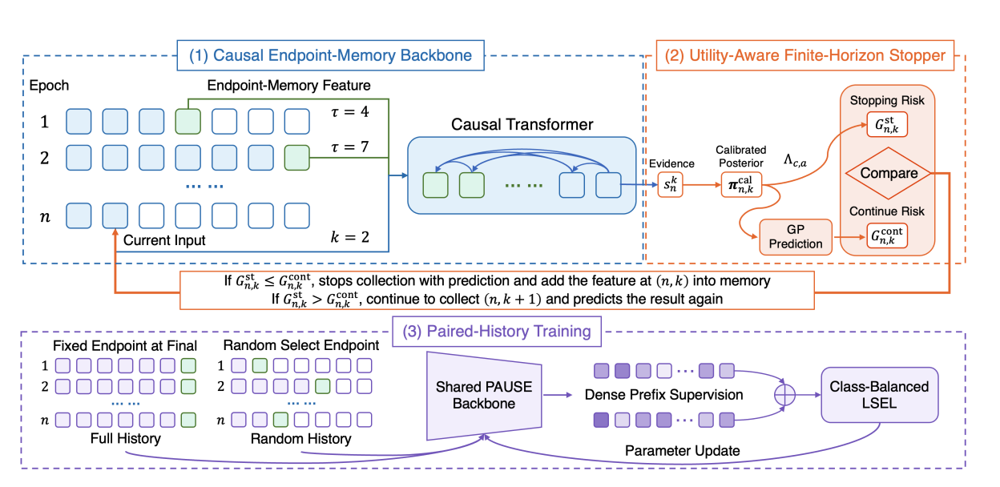
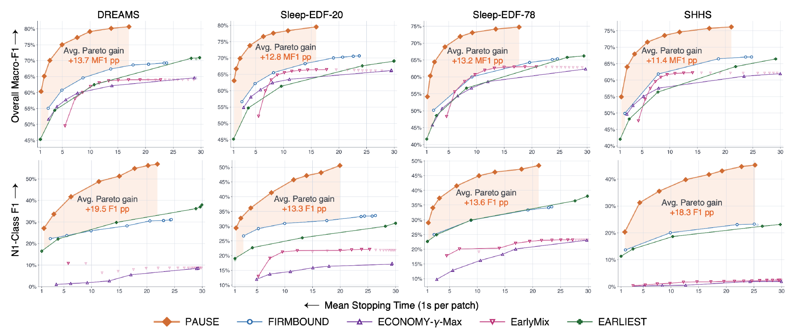

# PAUSE

Code for **Beyond Instance-Wise Early Classification: Resource-Efficient Sleep Staging with Stopping-Dependent Cross-Epoch Learning**.

[Code and reproduction guide](code/README.md) · [Supplementary material](PAUSE_Supplementary_ICDE2027.pdf)

PAUSE (Prefix-Adaptive and Utility-Aware Stopping) decides how much
single-channel EEG to acquire before assigning a sleep stage. After each
one-second patch, it compares the expected misclassification cost of stopping
with the expected cost of continuing. It carries the selected stopping endpoint
forward as context for later epochs. Paired-history training uses complete and
randomly truncated histories to reduce sensitivity to the histories generated
by the stopping policy.

*Figure 1 from the paper. PAUSE combines a causal endpoint-memory backbone,
a utility-aware finite-horizon stopper, and paired-history training.*

## Main results

Across DREAMS-SUB, Sleep-EDF-20, Sleep-EDF-78, and the evaluated SHHS
subset, PAUSE improves macro-F1 by 11.4–13.7 percentage points on average
over the upper envelope of four instance-wise early classification baselines
at comparable mean acquisition budgets (main paper, Fig. 2).

*Figure 2 from the paper. Mean EEG acquisition time is computed over all epochs
in the top row and over epochs labeled N1 in the bottom row. Shading shows the
gap between PAUSE and the best evaluated baseline at each comparable budget.*

At a mean acquisition budget of 10 seconds per 30-second epoch, PAUSE
achieves the following macro-F1 scores:

| Dataset | Macro-F1 |
| --- | ---: |
| DREAMS-SUB | 79.13% |
| Sleep-EDF-20 | 78.12% |
| Sleep-EDF-78 | 73.28% |
| SHHS subset | 73.94% |

These scores use 32-epoch inference windows and are linearly interpolated
between observed Pareto points (supplement, Sec. VIII).

## Code and reproduction

The repository includes PAUSE backbone training, out-of-fold calibration,
Gaussian-process stopping, and the PAUSE ablation variants. See the
[code guide](code/README.md) for processed data requirements and commands.
Run the commands from `code/`.

Raw datasets, trained checkpoints, baseline implementations, and the scripts
and saved results needed to regenerate the published comparison figures are
not included.

